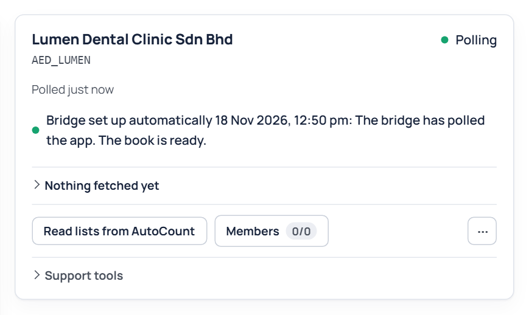
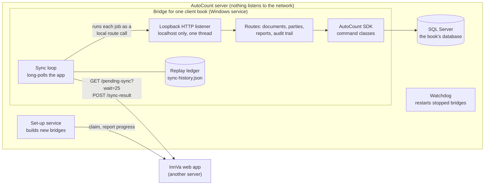
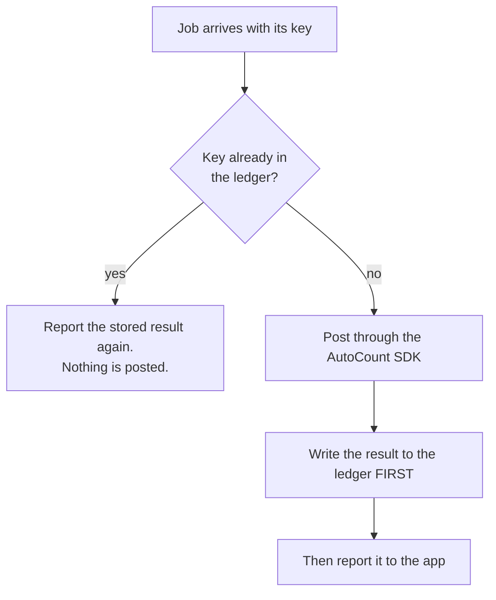

# AutoCount bridge: a desktop accounting SDK turned into a safe, outbound-only job worker

AutoCount Accounting 2.2 is a Windows desktop product. It has **no web API**: its only programming interface is a set
of .NET Framework assemblies that run in-process, on the machine where AutoCount is installed, against that machine's
SQL Server, under its licence.

This bridge is the C# service that makes AutoCount usable from a web app anyway. It boots a **headless AutoCount
session** on one client book, exposes it as a small JSON API on the server's own loopback address, and **polls the web
app for work over outbound HTTPS**. Nothing ever connects inward to the accounting server.

It is half of **[InnVa](https://github.com/trisglenanne9/innva)**, an app that reads supplier invoices with AI, has
people check them, and posts them into AutoCount. InnVa's page has the demo video.

> The source is private: it was built for a client. This page describes the design. Made by **Christine Lee**.

*A new client book in the app's Admin screen: its bridge was built, enrolled and started by the set-up service with
no manual steps, and has polled the app. Made-up book.*

---

## The shape of it

- **One process per client book.** An AutoCount session binds its book when it is created and can't be re-pointed
  (found by decompiling the vendor's assemblies). Each book therefore has its own process, folder, port, Windows
  service and key.
- **Outbound only.** The bridge keeps one HTTPS request waiting on the app (a long poll). When someone clicks Post,
  the app answers that request with the job at once, so there is no polling delay, and no inbound firewall rule.
- **One thread touches AutoCount.** The SDK session is not thread-safe, so every job goes through the bridge's own
  loopback HTTP listener, whose single-threaded loop serialises every call into AutoCount.
- **AutoCount does the writing.** The bridge never writes SQL (`SELECT` only). Every write goes through AutoCount's
  own command classes, so posting, numbering, stock costing and credit control behave exactly as in AutoCount's
  own screens.

## What it can do

| Area | What |
|---|---|
| **Documents** | One uniform API over **35 AutoCount document types**: the sales and purchase chains, AR and AP invoices, payments and notes, journals, cash book vouchers and stock transactions. `GET /documents/{type}/fields` lists every field AutoCount accepts, found by reflection. |
| **Read-back** | After every write, the document is **read back from the book's own tables** and returned with the result, so the app can compare what it sent with what AutoCount stored, field by field. |
| **Cancel and delete** | Both are verified by reading again, and both are safe to repeat (`alreadyCancelled`, `alreadyDeleted`). AutoCount's own refusals, such as a locked period or a document already knocked off, come back in AutoCount's words. |
| **Audit trail** | AutoCount's own event log: who created, edited, renumbered, cancelled or deleted a document, and when. The app reads it every minute to stay in step with what people do directly in AutoCount. |
| **Financial reports** | AutoCount's own **trial balance, profit and loss, balance sheet and cash flow**, produced by driving the same objects as AutoCount's report screens. Output as PDF, Excel or JSON figures. The figures were checked against the ledger, to the cent. |
| **Parties and lookups** | Create customers, suppliers and projects. Read the chart of accounts, tax codes, payment methods, fiscal calendar, open items per customer or supplier, and the book's own company details. |
| **Health** | `/health` (the one route without a key) reports the build, its commit, the AutoCount session and the sync loop's counters and last job. |

## Why a retry can never post twice

Every job carries an **idempotency key**, generated once by the app. Before a write, the bridge looks the key up in
its local replay ledger:

Writing to the ledger before reporting is the whole trick. If the bridge dies after AutoCount saved the invoice but
before the app heard about it, the evidence is already on disk, and the retry replays it.

The ledger also **fails closed**: if it can't be read, write jobs are refused (reads continue) until a person repairs
it. A failed cancel or delete is deliberately not recorded, because recording it would use up the key for a retry
that should be allowed.

## Errors a caller can act on

Every refusal is structured, so the app can show the reviewer exactly what to do next. For example:

| Code | Meaning |
|---|---|
| `{type}_duplicate_docno` | AutoCount refused the document number; carries the existing document's number and date |
| `duplicate_document` | The bridge's own backstop: same supplier, supplier invoice number and date already in the book |
| `autocount_rejected` | Any other AutoCount business rule, with AutoCount's own sentence |
| `value_too_long` | A value wider than its column, with the field, table and limit |
| `route_owned_field` | The caller sent a field the bridge sets itself |
| `cancel_refused` / `delete_refused` | AutoCount declined, for example a locked period |

## Running it

- **Built with what Windows already has.** It is compiled by the C# compiler that ships with .NET Framework
  (`csc.exe`): no Visual Studio, no NuGet, no SDK install on the accounting server. That keeps it to C# 5.
- **Every build is traceable.** The build stamps the git commit (and `+dirty` if the tree had changes) into the
  binary. `/health` reports it, so every running instance can be matched to its source.
- **Windows services with dependencies.** Each bridge runs under WinSW and declares its SQL Server instance as a
  dependency.
- **A watchdog.** A SQL Server update once stopped a bridge as a dependent service, and nothing started it again for
  hours. The watchdog script starts any automatic bridge left stopped, after waiting for SQL Server to settle.
- **New books build themselves.** When an admin adds a client book in the app, a set-up service on the accounting
  server claims it, creates the instance, and installs and starts the service. After a person's check it takes the
  bridge live and proves the first poll. It reports each step to the book's card in the app. The new bridge **enrols itself with a single-use code**, so no key ever passes
  through a person; the app stores only a SHA-256 hash of each key.
- **Scripts for the rest.** Provisioning, going live (which proves the first poll before reporting success),
  deploying to every instance, and verifying each instance's build by its hash.

## How it was proven

The bridge talks to client ledgers, so nothing was assumed:

- **Probe scripts** check each capability on a test book. The go-live gate for a document type is a round trip:
  post, read back, cancel, read back as cancelled. The write probes refuse to run against any book but the test book.
- **Reports were checked against the ledger.** Every figure the report route returned was re-added from the general
  ledger table by `SELECT`, and matched to the cent.
- **An assembly inspector** (`tools/inspect-autocount.cs`) asks the vendor's assemblies directly: types, properties,
  methods, and a method's IL with every operand resolved. Report generation was built by reading the IL of
  AutoCount's own report screens and driving the same objects in the same order.

## Lessons from the SDK

**Names are not evidence.** Each of these looked right in review and was wrong when measured:

| What the name suggested | What was true |
|---|---|
| The AP invoice detail table is `APInvoiceDetail` | It is `APInvoiceDTL` |
| `DocumentType` is an enum | It is a static class of string constants, so parsing it as an enum always threw |
| Reflection found the cancel method, so cancel works | It was found on the abstract type; the runtime type differs, and every cancel failed until that was fixed |
| A journal entry lives in table `JV`, like its document code | Its tables are `JE` and `JEDTL` |
| An event description ends with the document number | It ends with a line feed, so an end-anchored match never matched |
| A two-string delete method takes (document number, user) | One overload takes (supplier's invoice number, creditor code); the overload is now chosen by parameter name |

**Reads don't prove writes.** Every read worked against a book with the wrong AutoCount assemblies; writes then
failed on the same book. The pre-flight for a document type is its `/fields` route, which calls the same
construction a post does.

**Match the assemblies to the book.** Assemblies newer than a book's schema break on writes, because their entities
expect columns the older table lacks. Each instance points at the newest AutoCount install at or below its book's schema.

## By the numbers

| | |
|---|---|
| Built | 10 Sep to 16 Oct 2026, in production throughout |
| Commits | 186 |
| Code | about 7,000 lines of C# in 11 files, plus 27 PowerShell scripts |
| Builds | 40 numbered builds, each traceable to its commit |
| Document types | 35 behind one API |

## Made by

**Christine Lee**. The bridge and the web app were built on two machines that can't reach each other, so the two
halves were built to a written contract (the two sync endpoints above) plus numbered written replies.
